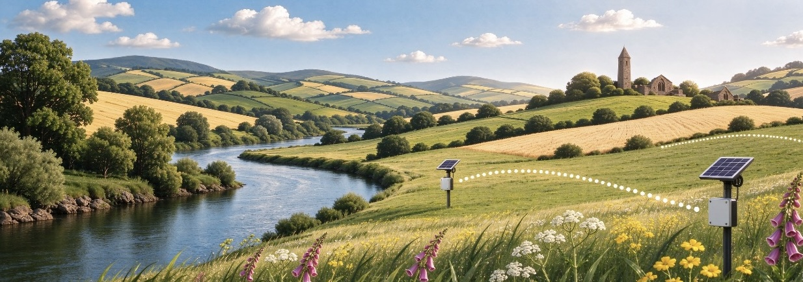
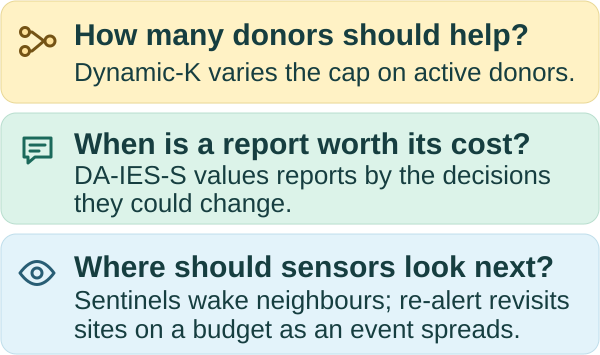
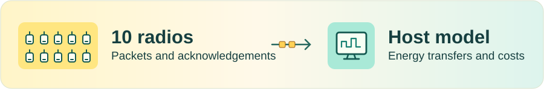

# Guoqing Lu

PhD candidate in the **Department of Computing and Mathematics**, South East Technological University (SETU), Waterford, Ireland. I study **energy collaboration** and **energy intelligence** in wireless sensor networks. I have also taught programming and computer networks.

[Dynamic-K demo](https://github.com/Guoqing0110/dynamic-k-demo) · [Research questions](#research-questions-and-contributions) · [Selected papers](#selected-papers) · [ORCID](https://orcid.org/0000-0002-2764-5787)

**A network can have energy to spare and still miss a local event.** A sensor beside the event may be running low while a neighbour has energy to share. My PhD project, **EdgeEnergy**, follows that problem through three decisions: how to share the energy, what the scheduler needs to know before acting, and where the next observation matters most.

## Research questions and contributions

Our review of **165 full texts** brought two questions into focus. **Energy collaboration** asks where and when energy should reach a node. **Energy intelligence** asks how measured, estimated or predicted energy conditions should change a network decision. The three studies follow those decisions through to their effect on sensing.

### 1. How many donors should help one receiver?

An extra donor can support a depleted node, but every transfer also loses energy. [**Dynamic-K**](https://doi.org/10.1016/j.adhoc.2026.104346) lets an existing scheduler adjust the **maximum number of simultaneous donors per receiver**. Feedback from previous transfers helps it weigh a more even energy distribution against transfer loss. The underlying scheduler still chooses the donors and the amounts.

Across **five schedulers in the 25-node simulation**, the mean of the five node-energy standard deviations fell by **64.4%** versus a fixed one-donor limit, while mean transfer efficiency moved from **52.9% to 52.5%**. In **68 matched pairs of ten-node hardware-in-the-loop (HIL) trials**, the host adjusted the limit using only the state reports that arrived.

[**Run the Dynamic-K example →**](https://github.com/Guoqing0110/dynamic-k-demo) See what a second donor permits, then recreate the five-scheduler figure from the published table with one Python command.

### 2. Which energy reports are worth paying for?

Choosing donors assumes the scheduler knows who can afford to help. A stale reading from one potential donor could change the decision; an equally stale reading elsewhere might make no difference. **Decision-Aware Information–Energy Scheduling with Safeguarded Payer Reserves (DA-IES-S)** estimates each node’s available energy, values a new report by the feasible transfer choices it could change, and checks the reserves of the nodes that would pay to obtain it. A delivered report can inform a subsequent transfer decision.

Seven policies faced matched inputs in **735 reference-network trajectories** and **1,176 multihop-corridor trajectories**. In the short-path network, allowing reports to return along a transfer route changed no action. In the multihop corridor, that option reduced reporting cost relative to direct return while meeting the study’s service margin. A separate **offline HIL replay** gave each policy the same recorded packet arrivals, so differences in their decisions could be traced to the policy.

### 3. Which observation is worth the energy?

Sharing energy and choosing better reports preserve operating capacity. What should that capacity buy when an event begins? In our [**sentinel-assisted sampling study**](https://doi.org/10.1109/ISSC70693.2026.11792288), sentinels keep watch while other nodes sample sparsely. A local change wakes nearby nodes to verify it. A separate mechanism, **bounded delayed-front re-alert**, uses earlier negative checks to decide which sites merit another look as a confirmed event spreads.

On a **54-node measured temperature trace** with controlled events, local alerts raised the anomaly-window sampling ratio from **0.439 to 0.933** relative to sparse Kalman-filter sampling. In local HIL trials, physical acknowledgements showed which wake commands reached a node in response to a virtual event. The moving-front mechanism was evaluated separately on **two further trace windows**.

How the ten-node experiments separate radio events from modelled energy

The nodes exchange real packets and acknowledgements. In the two energy-transfer studies, the host tracks energy balances and models the transfers and their costs. This makes it possible to distinguish a decision the controller intended from a message that arrived in time to support it.

## Selected papers

### Journal and conference publications

- [Dynamic-K adaptation framework for energy transfer coordination in wireless sensor networks](https://doi.org/10.1016/j.adhoc.2026.104346) — Guoqing Lu and Bernard Butler. *Ad Hoc Networks*, 2026.
- [Adaptive Sampling for Spatiotemporal Anomaly Monitoring in Wireless Sensor Networks](https://doi.org/10.1109/ISSC70693.2026.11792288) — Guoqing Lu, Yixuan Sun, Yiwen Jiang and Bernard Butler. *2026 36th Irish Signals and Systems Conference (ISSC)*, pp. 1–6. [Open-access author manuscript](https://arxiv.org/abs/2607.15235).

### Submitted manuscripts

- **Energy Collaboration and Energy-Aware Network Control in Wireless Sensor Networks: Mechanisms and Trade-offs** — Guoqing Lu and Bernard Butler. Revised manuscript resubmitted to the *International Journal of Distributed Sensor Networks*, November 2026.
- **Using partially observable state for energy cooperation in energy-constrained sensor networks** — Guoqing Lu and Bernard Butler. Submitted to *ACM Transactions on Sensor Networks*.
